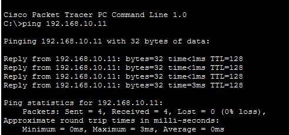
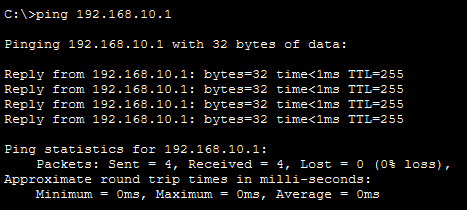
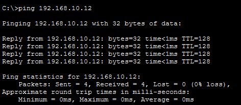
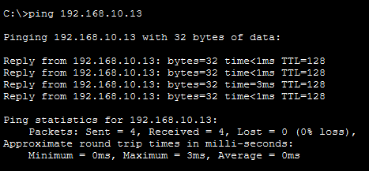

# Proyecto 01 — Diseño y configuración de una red LAN empresarial

## Descripción
Laboratorio práctico desarrollado con Cisco Packet Tracer para diseñar, configurar y verificar una red LAN con direccionamiento IPv4 estático.

## Objetivos
- Diseñar una topología en estrella.
- Configurar un router Cisco 2911.
- Asignar direcciones IPv4 estáticas.
- Verificar la conectividad mediante ping.
- Analizar las asociaciones IPv4-MAC mediante ARP.

## Topología


## Dispositivos
- 1 router Cisco 2911
- 1 switch Cisco 2960-24TT
- 4 ordenadores PC-PT
- 5 cables Ethernet directos

## Direccionamiento IPv4
| Dispositivo | Dirección IPv4 | Máscara | Puerta de enlace |
|---|---|---|---|
| Router0 | 192.168.10.1 | 255.255.255.0 | — |
| PC0 | 192.168.10.10 | 255.255.255.0 | 192.168.10.1 |
| PC1 | 192.168.10.11 | 255.255.255.0 | 192.168.10.1 |
| PC2 | 192.168.10.12 | 255.255.255.0 | 192.168.10.1 |
| PC3 | 192.168.10.13 | 255.255.255.0 | 192.168.10.1 |

## Configuración del router
```text
enable
configure terminal
interface gigabitEthernet 0/0
ip address 192.168.10.1 255.255.255.0
no shutdown
end
write memory
show ip interface brief
```


## Configuración IPv4 del PC0


## Pruebas de conectividad
Desde PC0 se realizaron pruebas ICMP hacia PC1, PC2, PC3 y Router0. Las cuatro pruebas recibieron 4 de 4 respuestas, sin pérdida de paquetes.

| Destino | IP | Resultado |
|---|---|---|
| PC1 | 192.168.10.11 | 0 % pérdida |
| PC2 | 192.168.10.12 | 0 % pérdida |
| PC3 | 192.168.10.13 | 0 % pérdida |
| Router0 | 192.168.10.1 | 0 % pérdida |






## Tabla ARP
El comando `arp -a` permitió observar las asociaciones dinámicas entre direcciones IPv4 y direcciones MAC aprendidas por PC0.


## Conclusiones
Se implementó una red LAN en estrella con direccionamiento IPv4 estático. Las pruebas realizadas desde PC0 confirmaron conectividad con los tres ordenadores restantes y con la interfaz del router. El laboratorio permitió practicar configuración de interfaces, diagnóstico ICMP y análisis básico de ARP.

## Archivo del laboratorio
[Descargar proyecto Cisco Packet Tracer](Proyecto01_Red_LAN_Empresarial.pkt)

**Herramienta:** Cisco Packet Tracer

**Área:** Fundamentos de redes y soporte IT
